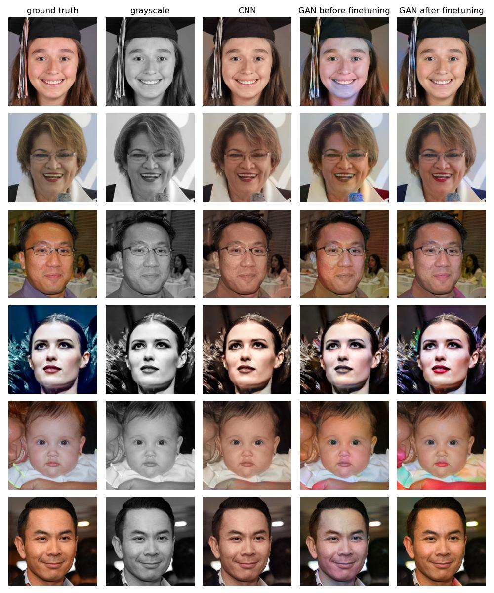

# CNN vs GAN Face Colorization Comparison

This code repository compares a CNN model trained by our team and a pre-trained but tuned GAN on colorizing the faces of people. Our models are trained/tuned on the [Flickr-Faces-HQ Dataset (FFHQ)](https://github.com/NVlabs/ffhq-dataset). 

To run the demo of the trained CNN and GAN, utilize the demo.ipynb Jupyter Notebook. The demo can be run in any environment that supports python (i.e. VSCode, PyCharm, etc.) or on Google Colab. The demo **requires Torch to be installed**, this is not necessary on Google Colab as it comes pre-installed.

If you wish to train the CNN model, see the CNN-faces.ipynb file. If you wish to train, pre-train, or tune the GAN model, see the GAN/finetune_GAN.ipynb file.

## Installation
Requires Python version 3.10

Clone this repository

```sh
git clone git@github.com:sengercoding/CVfinal.git cv_final_group23
cd cv_final_group23
```

Create venv and install requirements:
```sh
python3.10 -m venv .
source bin/activate
pip install -r requirements.txt
```


## Example colorizations (you can produce your own in demo.ipynb)




## Project Organization
    
    
    ├── CNN                               <- contains all the CNN-only related files
    │   ├── CNN-faces.ipynb               <- here the CNN was trained in Colab
    │   ├── checkpoints                   <- here model checkpoints are saved
    │   └── src
    │       ├── colorize.py               <- functions for colorization
    │       ├── model.py                  <- CNN model builder
    │       └── visualize.py              <- plots CNN outputs
    ├── GAN                               <- contains all the CNN-only related files
    │   ├── finetune_GAN.ipynb            <- here the GAN was trained in Colab
    |   ├── checkpoints                   <- here model checkpoints are saved
    │   └── src
    │       ├── colorize.py                <- functions for colorization
    │       ├── get_gan_checkpoints.py     <- downloads checkpoints from google drive if they do not exist
    │       ├── model.py                   <- GAN model
    │       └── visualize.py               <- plots GAN outputs and losses
    ├── README.md
    ├── data
    │   └── faces_val             <- 2000 images for validation and testing
    ├── demo.ipynb                <- demo of functions
    ├── logs
    ├── requirements.txt          <- required libraries
    ├── results                   <- visualizations and arrays from training
    ├── src
    │   ├── evaluate.py          <- eval functions
    │   └── visualize.py         <- visulaize CNN and GAN together


## License Notices
Our demo utilizes code and practices from the following repositories: 
[Deep-Learning](https://github.com/moein-shariatnia/Deep-Learning/tree/main?tab=MIT-1-ov-file#readme)


MIT License

Copyright (c) 2020 moein-shariatnia

Permission is hereby granted, free of charge, to any person obtaining a copy
of this software and associated documentation files (the "Software"), to deal
in the Software without restriction, including without limitation the rights
to use, copy, modify, merge, publish, distribute, sublicense, and/or sell
copies of the Software, and to permit persons to whom the Software is
furnished to do so, subject to the following conditions:

The above copyright notice and this permission notice shall be included in all
copies or substantial portions of the Software.

THE SOFTWARE IS PROVIDED "AS IS", WITHOUT WARRANTY OF ANY KIND, EXPRESS OR
IMPLIED, INCLUDING BUT NOT LIMITED TO THE WARRANTIES OF MERCHANTABILITY,
FITNESS FOR A PARTICULAR PURPOSE AND NONINFRINGEMENT. IN NO EVENT SHALL THE
AUTHORS OR COPYRIGHT HOLDERS BE LIABLE FOR ANY CLAIM, DAMAGES OR OTHER
LIABILITY, WHETHER IN AN ACTION OF CONTRACT, TORT OR OTHERWISE, ARISING FROM,
OUT OF OR IN CONNECTION WITH THE SOFTWARE OR THE USE OR OTHER DEALINGS IN THE
SOFTWARE.
